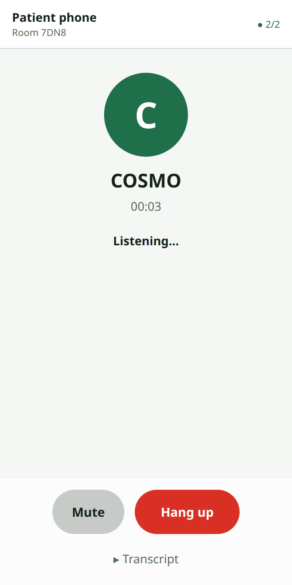
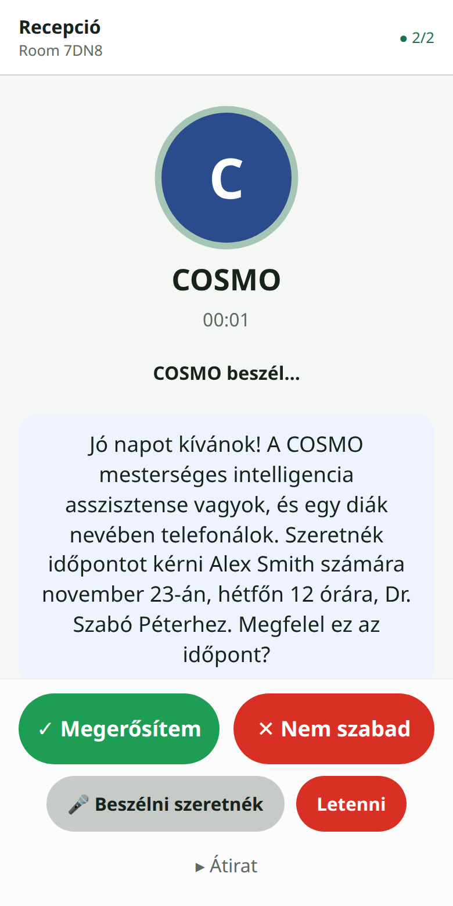
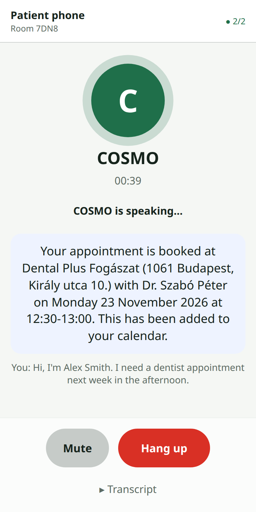

# COSMO – Hungarian Phone Agent

> Team COSMO · Agentic AI Hackathon · GDG on Campus UD

## Problem
International students in Hungary often need to handle everyday tasks by phone, such as booking a doctor or dentist. Many receptionists speak only Hungarian, so a simple booking becomes a stressful barrier.

## What it does
The student tells COSMO in English what they need, for example *"Book me a dentist next week, in the afternoon."* COSMO then:

1. Picks a suitable clinic from the project's mock Budapest clinic data.
2. Calls the receptionist in Hungarian. Its first sentence says that it is an AI assistant calling on the student's behalf. In the demo a teammate plays the receptionist through the microphone or by typing.
3. Negotiates a time slot and checks it against the requested time window and clinic hours.
4. Adds the appointment to the student's calendar only after receptionist confirmation.
5. Sends the student a short summary in English.

**Hackathon MVP:** one task, booking a clinic appointment. The receptionist is simulated; no real clinic is contacted and no phone call is placed. If the receptionist refuses to speak to an AI, COSMO tells the student to join the call; today this is shown as a scripted scenario, with no live transfer.

**Future work:** real phone calls, a live handoff where COSMO brings the student onto the call as an interpreter, and a general two-way live translation mode.

## Architecture
```
Student (English request) → React frontend → ADK API server (port 8000)
Receptionist (Hungarian, browser mic)
   → React frontend → voice bridge (FastAPI, port 8001)
   → STT → committed transcript to ADK agent → TTS
   → React transcript, English subtitles, and audio playback
```
The agent works on **text in, text out**; voice and frontend sit around it, so each part can be built and tested on its own. The browser sends only committed receptionist transcripts to the agent. English translations are display aids; the original transcript is sent unchanged. The sample-data mode remains available without the agent or voice services.

## Agent tools
The model decides what to do; plain Python computes and checks. Every tool returns a `dict` with a `status` field.

| Tool | What Python does |
|---|---|
| `find_clinics(specialty, district)` | Picks a matching mock clinic from `phone_agent/data/clinics.json` |
| `resolve_time_window(when, part_of_day)` | Turns "next week, afternoon" into real Budapest dates and hours (weekends skipped) |
| `check_slot(clinic_id, slot_start, when, part_of_day)` | Decides whether an offered time fits the patient's window and the clinic's opening hours |
| `create_calendar_event(clinic_id, slot_start, duration_min, patient_name, notes)` | Writes the confirmed appointment as an `.ics` file to `bookings/` (git-ignored) |
| `say(to, text)` | The only way the agent speaks: to `patient` (English) or `receptionist` (Hungarian) |

Messages to the agent are tagged with the speaker: `[patient|en] ...` or `[receptionist|hu] ...`. `phone_agent/contract.py` converts the voice layer's JSON events to and from ADK's `/run` format.

## Tech stack
| Layer | Tool |
|---|---|
| Agent | Google ADK, Gemini `gemini-3.5-flash-lite` |
| Agent API | `adk api_server` (port 8000) |
| Voice bridge | FastAPI (`voice.server`, port 8001), ElevenLabs Scribe and TTS, Gemini translation |
| Frontend | React |
| Calendar | `.ics` file generated in Python |

## Team
| # | Member | Role | Owns |
|---|---|---|---|
| 1 | Mustafa Ali Mohsin Albusultan **(Leader)** | Backend & agent | ADK root agent, instruction, tools (clinic search, slot finding), `adk api_server`, error and timeout handling |
| 2 | Noureldeen Elshawaf | Voice AI engineer | ElevenLabs Scribe live STT, microphone streaming, TTS, audio playback and interruption |
| 3 | Redha Ali Hussein Hasan Al-Ashwal | Frontend | React interface, live transcript, call controls, language selection |
| 4 | Moises Raul Raunde | Integration & product | Integrating all parts, Hungarian pronunciation tests, demo scenario, presentation |

Full plan and timeline: [phone-agent-plan.md](phone-agent-plan.md).

Demo scenarios and rehearsal checks: [docs/dev4-demo-runbook.md](docs/dev4-demo-runbook.md).

Hackathon pitch deck (8 slides, PowerPoint): [docs/pitch/COSMO-Hackathon-Pitch.pptx](docs/pitch/COSMO-Hackathon-Pitch.pptx).

## Setup
Requires Python 3.10+.

```bash
git clone https://github.com/Mustafa-8/cosmo-phone-agent.git
cd cosmo-phone-agent
python3 -m venv .venv
source .venv/bin/activate        # Windows: .venv\Scripts\activate
pip install -r requirements.txt
cp .env.example .env             # then fill in your own keys
```

Start these services in separate terminals from the repository root:

```bash
adk api_server --allow_origins http://localhost:5173
uvicorn voice.server:app --port 8001
cd frontend
npm ci
npm run dev
```

- Vite 8 requires Node.js 20.19+ or 22.12+.
- `--allow_origins` allows the browser (Vite on port 5173) to call the ADK API on port 8000.
- After changing agent code, **restart** the server and start a **new session** before testing.
- To debug the agent alone, use ADK's own chat UI instead of the frontend: `adk web` (shows every tool call). If it fails with `_make_subprocess_transport NotImplementedError`, run `adk web --no-reload`.
- Before a demo, run `python integration/scripts/health_check.py` to check both servers and the keys.

Open the Vite URL, select **Live agent**, start a call, and use **Speak as receptionist** for the Hungarian role-play. Typed receptionist replies remain available. **Sample data** works without provider keys or backend services. The voice server keeps provider keys on the backend; use fictional patient details only.

Run the offline tests (no provider calls, no keys needed):

```bash
for t in contract clinics time_window slots calendar_event booking_guard; do python -m tests.test_$t; done
cd frontend && npm run lint && npm run build
```

The voice layer's tests use `pytest`, which is not in `requirements.txt`. Install it once with `pip install pytest`, then run `python -m pytest voice/tests`.

## Two-phone demo (real call)

A patient phone (English) and a clinic reception phone (Hungarian) talk through COSMO. The patient just speaks;
COSMO picks a clinic, doctor and free slot and asks the reception, who only taps **Confirm** or **Deny**
(or joins the line if a human conversation is needed).

<p>



</p>

**How to run and operate it, step by step, with screenshots and a video: [docs/PHONE_DEMO.md](docs/PHONE_DEMO.md).**
Quick start: `./run_online.sh`, then open `<link>/?phone` on two phones.

### QR codes (live demo link)

Scan with a phone. The patient and reception codes join the same room (**DEMO**), so the two phones pair automatically.
Tap **New call** on the patient phone between rehearsals.

| Main website | Patient phone | Reception phone | Testing (choose a role) |
|:---:|:---:|:---:|:---:|
|  |  |  |  |
| [https://belly-importance-introducing-cocktail.trycloudflare.com/](https://belly-importance-introducing-cocktail.trycloudflare.com/) | [patient, room DEMO](https://belly-importance-introducing-cocktail.trycloudflare.com/?phone&role=patient&room=DEMO) | [reception, room DEMO](https://belly-importance-introducing-cocktail.trycloudflare.com/?phone&role=receptionist&room=DEMO) | [choose role](https://belly-importance-introducing-cocktail.trycloudflare.com/?phone) |

> These codes point to the Cloudflare quick-tunnel link of today's demo. It works only while `./run_online.sh`
> is running on the demo laptop, and a restart gives a new link, so the codes must then be regenerated.

## Online demo (public link)
`./run_online.sh` serves the agent, the voice bridge and the website on one port (`serve.py`) and opens a public Cloudflare quick tunnel (needs `cloudflared`). The link works only while your laptop runs it and changes on every start.

- **Access code:** only the website's files are public. The agent, the voice bridge, the API docs and conversations need the demo code (`demo_access.py`, HttpOnly cookie). Set `DEMO_ACCESS_CODE` in `.env`, or a random code is printed next to the link. Share the link and the code only with people who should use the demo, because they use our Gemini and ElevenLabs credits.
- Each browser gets its own random user id, so visitors cannot read each other's conversations.
- For a demo on your own laptop, `localhost` is enough and safer than a public link.

## Free-tier limits
- `gemini-3.5-flash-lite` on the free tier allows **15 requests per minute per Google project**. One booking call uses about 8–10 requests, because every tool step is a request.
- Use API keys from **different Google projects** for the agent (`GOOGLE_API_KEY`) and for the voice layer's translation (`GEMINI_API_KEY`), so they don't share one quota. The voice layer translates every Hungarian line, so one call turn uses about 5 requests when both share a key.
- During rehearsals, wait about a minute between full test calls. A `429 RESOURCE_EXHAUSTED` in the server log means the quota ran out.

## Frontend

The React interface for the student appointment-booking flow is in `frontend/`.

```bash
cd frontend
npm install
npm run dev
```

The frontend supports both the live ADK/voice flow and sample data. The live clinic conversation remains a role-play and does not place a phone call. Do not enter real personal or medical information.

## Rules for contributors
- Never commit `.env` or paste keys in chat. Only `.env.example` (variable names) is committed.
- Work on your own branch (`<name>/<feature>`), pull before you push.
- Nobody pushes to `main` directly. Open a pull request and wait for the leader's review; the leader merges.
- Every agent tool has type hints and a precise docstring, and returns a `dict` with a `status` field.
