# Two-phone demo: how to operate it

COSMO sits between two real phones. The **patient** speaks English, the **clinic reception** gets
COSMO's request in Hungarian and only has to **confirm or deny**. Nobody types; each phone hears COSMO
only in its own language.

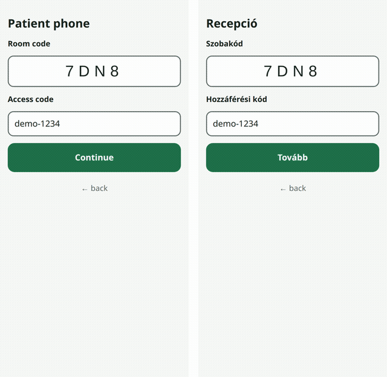

▶ [Video (MP4)](media/demo.mp4)

## QR codes (live demo link)

Scan with a phone. The patient and reception codes join the same room (**DEMO**), so the two phones pair automatically.
Tap **New call** on the patient phone between rehearsals.

| Main website | Patient phone | Reception phone | Testing (choose a role) |
|:---:|:---:|:---:|:---:|
| 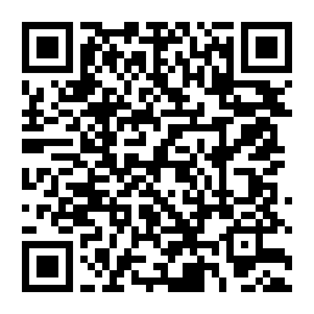 | 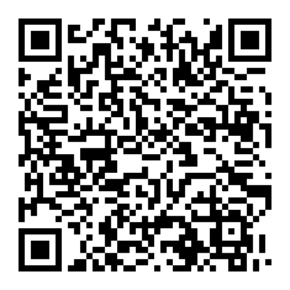 | 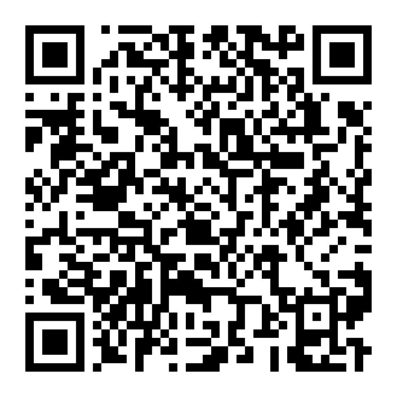 | 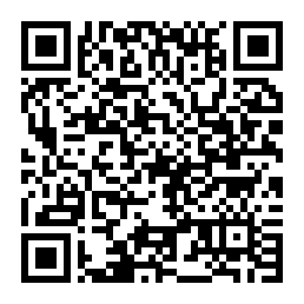 |
| [https://belly-importance-introducing-cocktail.trycloudflare.com/](https://belly-importance-introducing-cocktail.trycloudflare.com/) | [patient, room DEMO](https://belly-importance-introducing-cocktail.trycloudflare.com/?phone&role=patient&room=DEMO) | [reception, room DEMO](https://belly-importance-introducing-cocktail.trycloudflare.com/?phone&role=receptionist&room=DEMO) | [choose role](https://belly-importance-introducing-cocktail.trycloudflare.com/?phone) |

> These codes point to the Cloudflare quick-tunnel link of today's demo. It works only while `./run_online.sh`
> is running on the demo laptop, and a restart gives a new link, so the codes must then be regenerated.

## 1. Start the server (laptop, once)

```bash
cd cosmo-phone-agent
./run_online.sh
```

It prints three things:

```
COSMO is online:  https://<random>.trycloudflare.com
Access code:      <code>
```

Keep this terminal open (closing it ends the demo). The link changes every time you restart.
Every heard sentence, COSMO reply and button press is printed here, which is the first place to look
if something goes wrong:

```
[K7Q2] heard patient: Hi, I'm Alex Smith. I need a dentist appointment next week in the afternoon.
[K7Q2] COSMO -> receptionist: Jó napot kívánok! A COSMO mesterséges intelligencia asszisztense vagyok…
[K7Q2] reception pressed confirm
```

## 2. Join with both phones

| | Patient phone | Reception phone |
|---|---|---|
| Open | `https://<link>/?phone` → **I am the patient (English)** | The link shown on the patient phone (it already contains the room and the code) |
| Fill in | Room code (pre-filled) + access code → **Continue** | Pre-filled → **Tovább** |

<p>
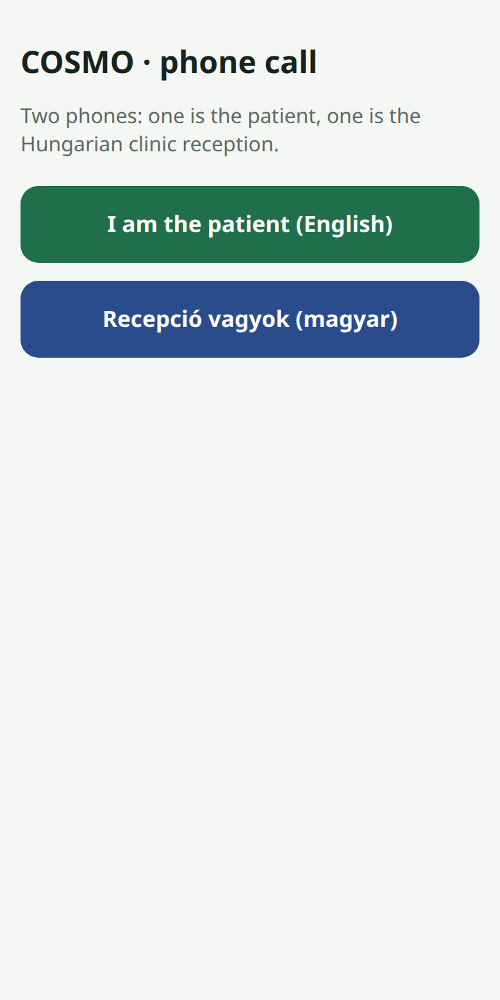
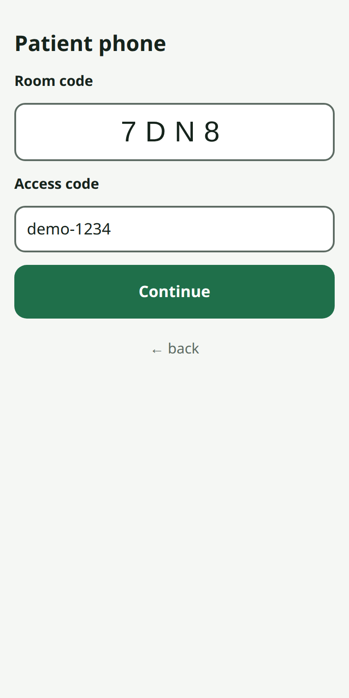
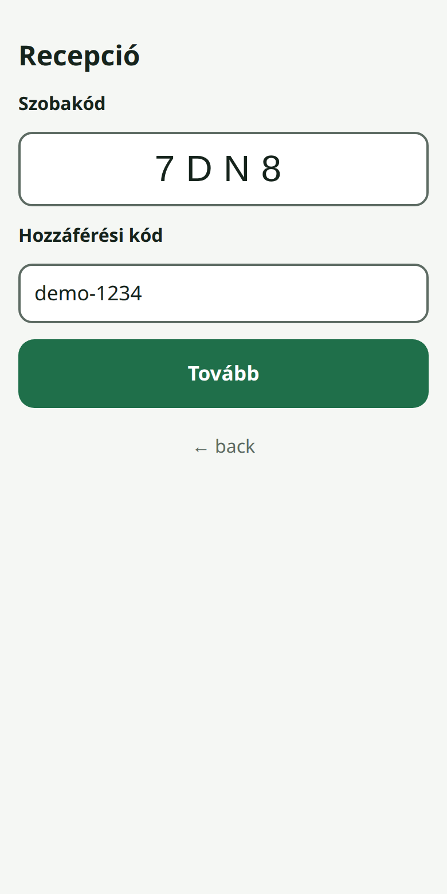
</p>

## 3. The call

| Step | Patient phone (English) | Reception phone (Hungarian) |
|---|---|---|
| 1 | Tap **Call COSMO**, then just talk: *"Hi, I'm Alex Smith. I need a dentist appointment next week in the afternoon."* The mic stays open; no more tapping. | Waits. Shows *"COSMO a pácienssel beszél…"* |
| 2 | COSMO answers: which clinic, doctor and time it is asking for. | The phone **rings** (*Bejövő hívás…*). |
| 3 | | Tap **Hívás fogadása**. COSMO says the AI disclosure and asks to book the patient with that doctor and time. |
| 4a | COSMO confirms: clinic, address, doctor, date, time, added to calendar. | Tap **✓ Megerősítem** (confirm). COSMO thanks and says goodbye. |
| 4b | COSMO says the clinic declined and which new time it asks for. | Tap **✕ Nem szabad** (deny). COSMO proposes the **next free slot**; back to 4a/4b. |
| Only if needed | | Tap **🎤 Beszélni szeretnék** to join the line and speak Hungarian (e.g. a question). COSMO handles it. |

<p>
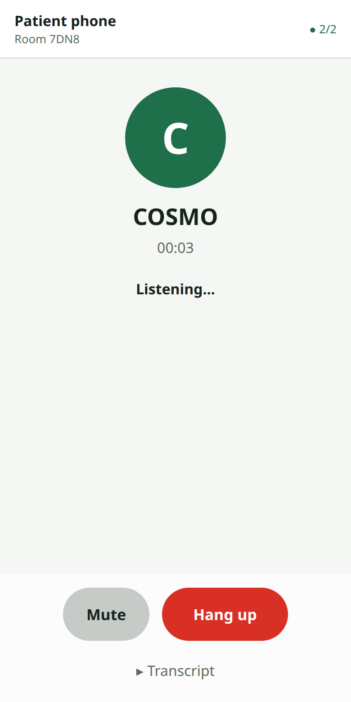
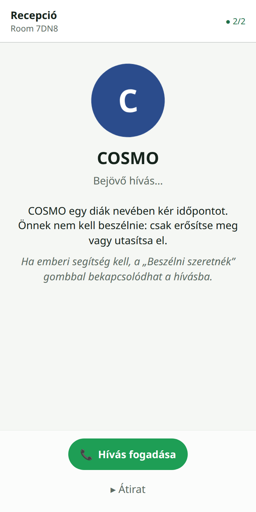
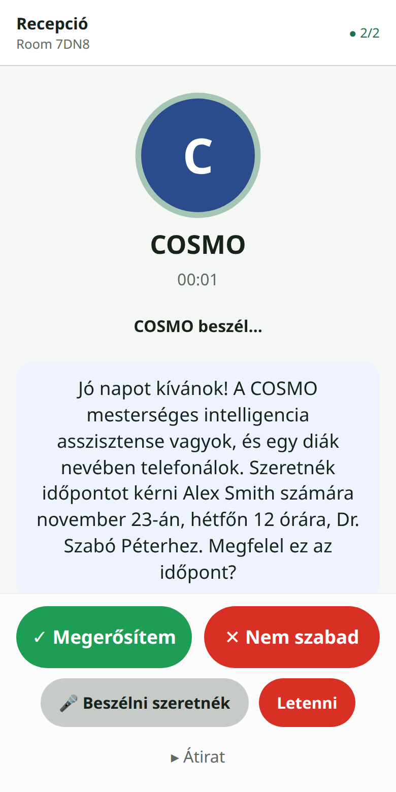
</p>
<p>
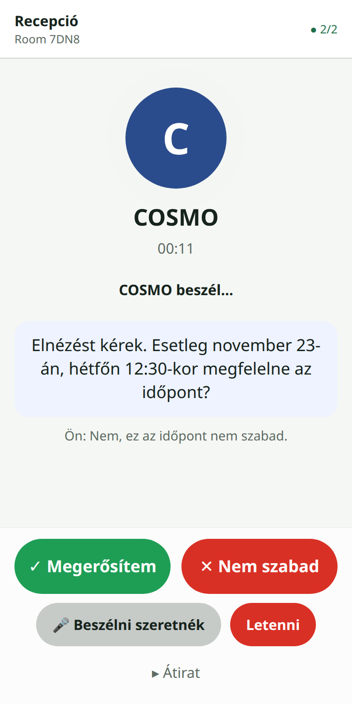
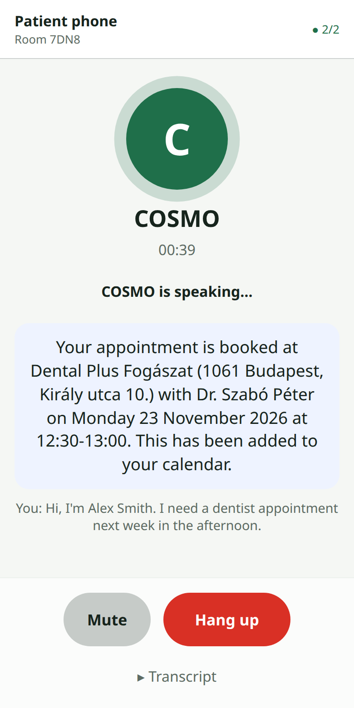
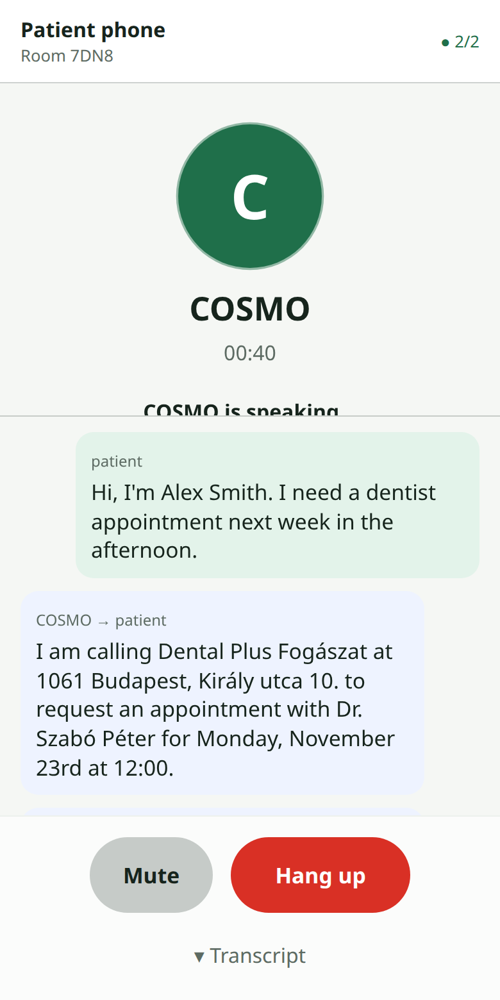
</p>

**Mute** pauses the patient's mic, **Hang up** ends the call, **New call** (patient) clears the room,
**Transcript** shows the full conversation (useful for the jury).

## How it works

```
Patient phone ──mic──▶ Scribe (EN) ─┐                         ┌─▶ ElevenLabs EN ─▶ patient speaker
                                    ├─▶ call room ─▶ COSMO ───┤
Reception buttons / mic ─▶ (HU) ────┘   voice/call.py  agent  └─▶ ElevenLabs HU (Andris) ─▶ reception speaker
```

- `phone_agent/tools/plan.py`: Python picks the clinic, a doctor and the first free slot (and the next one after a deny). The model never invents them.
- `voice/call.py`: joins speech fragments (1.2 s pause), one agent turn at a time, sends every message to both phones with English subtitles.
- While either phone plays COSMO, both mics pause, so neither phone transcribes COSMO.

## Tips and troubleshooting

- **Use the link the script printed this time.** Rooms and the link reset on every restart.
- **iPhone:** while the mic is open, iOS may play through the quiet earpiece. Use headphones on the patient phone, or an Android phone.
- **Keep the phones a few metres apart**, in a quiet room.
- **Slow reply:** Gemini sometimes stalls; COSMO gives up after 10 s and retries (up to 3 times).
- **"Wrong access code":** copy the code from the terminal; it changes per run unless `DEMO_ACCESS_CODE` is set in `.env`.
- Settings in `.env`: `AGENT_MODEL`, `AGENT_TIMEOUT_MS`, `CALL_HOLD_SECS`, `VOICE_ID_HU`, `DEMO_ACCESS_CODE`.
- Synthetic data only: use fictional patient names.
